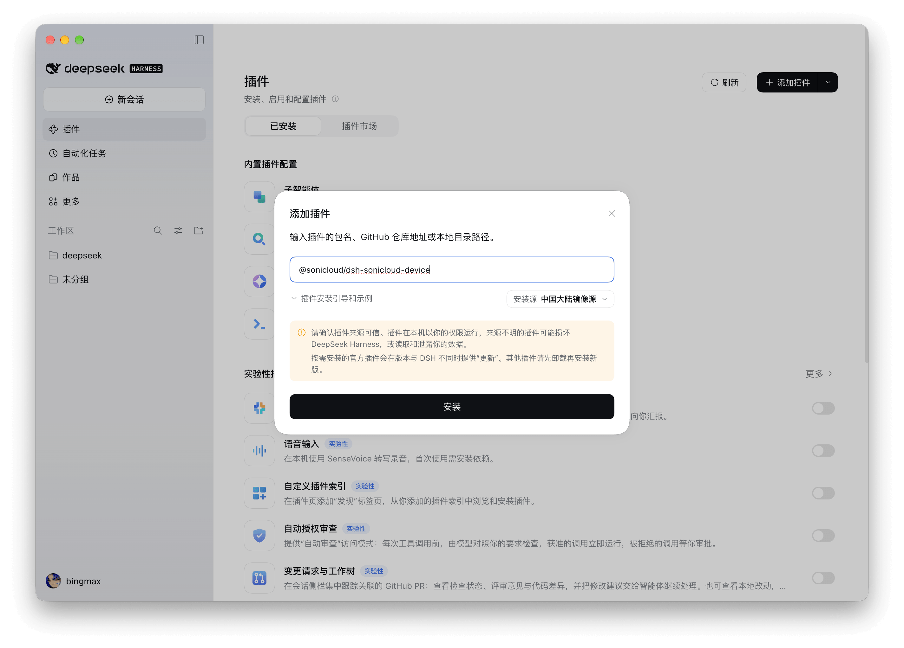
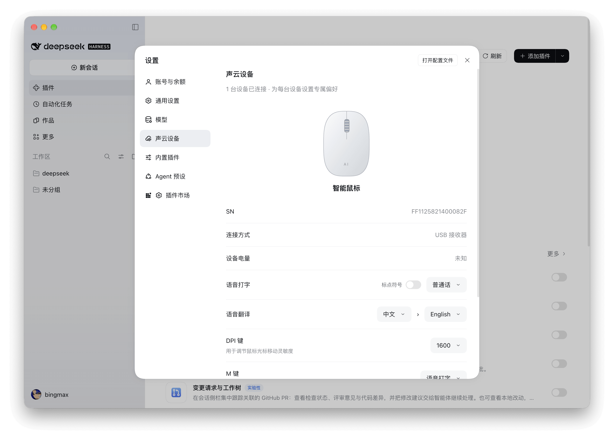

# Sonicloud Smart Mouse Plugin

English | <a href="README.zh.md">简体中文</a>

Use your Sonicloud smart mouse to dictate, translate, and search in desktop apps, or enter text directly into an AI conversation in DeepSeek Harness. Sonicloud Devices lets you save language, button, and sensitivity settings separately for each mouse.

**Purchase a Sonicloud mouse to use speech recognition and voice translation for free.**

## Requirements

- DeepSeek Harness **0.2.1-rc.5 or later**.
- A supported Sonicloud smart mouse connected via Bluetooth or a 2.4 GHz USB receiver.
- Network access to the speech service.

Supports Apple silicon Macs and Windows x64. The plugin identifies your mouse and connects to the services automatically, with no authentication details to enter.

## Installation and activation

1. Open DeepSeek Harness and select **Plugins (插件)** in the sidebar.
2. Click **Add Plugin (添加插件)** in the upper-right corner.
3. Enter **@sonicloud/dsh-sonicloud-device** and click **Install (安装)**.
4. Once installed, enable the plugin and open **Settings → Sonicloud Devices (设置 → 声云设备)** to view and configure your mouse.

## Features

| Feature | How to use it |
| --- | --- |
| Voice typing | Assign Voice Typing to the voice or M button. Hold to speak, then release to insert text into the current app's input field without sending it |
| Voice translation | Choose source and target languages and assign Voice Translation to the voice or M button. Hold to speak, then release to insert the translation |
| Voice search | Assign Voice Search to the M button and choose Baidu, Bing, or Google. Speak your query and release to search |
| AI conversations | Hold the AI button to speak, then release to fill a Harness conversation. Auto-send is enabled by default and can be turned off in settings |
| Buttons and sensitivity | Assign Enter, Backspace, Open Link, or other actions to the M button, and adjust mouse DPI |
| Multiple mice | View each mouse's connection, battery level, and serial number, and save its language, button, and sensitivity settings separately |

Manage these options in **Settings → Sonicloud Devices (设置 → 声云设备)**. Changes save automatically. **Restore Defaults (恢复默认)** resets only the current mouse, and reconnecting restores its saved settings. The left navigation bar also shows a **Sonicloud Devices (声云设备)** panel with the same device management UI by default; use the Sidebar (侧边栏) switch on the Sonicloud Devices title row to hide or restore it. Hiding the panel does not affect the settings page.

## Getting started

### Voice typing and translation

1. Turn on your mouse, select Bluetooth or 2.4 GHz mode, and connect it.
2. Set the button action and language in Sonicloud Devices. For translation, choose different source and target languages.
3. Place the cursor in an editable field in the target app, then hold the assigned button to speak.
4. Release the button, wait for the text or translation to appear, and review it before sending.

Audio comes from the mouse. Recognized text and processing status appear in a separate overlay at the bottom of the screen without taking input focus. Click the overlay's close button or disconnect the mouse to cancel. Multiple mice can be connected, but only one voice operation can run at a time.

Keep the target window, document, and input position unchanged during recording, and avoid typing, clicking, or scrolling. If the target changes or the app does not support automatic insertion, the overlay keeps the result available to copy. If translation fails, you can copy the recognized source text.

On macOS, automatic insertion requires allowing **Sonicloud Voice** under **System Settings → Privacy & Security → Accessibility**. Recognition and copying still work without this permission. Insertion temporarily uses the clipboard, then restores its previous contents while preserving anything newly copied in the meantime.

On Windows, recognized text is typed live into the focused field character by character through the typer injection library, with automatic corrections while you speak; translation types only the final translated text. Character injection never touches the clipboard. Password fields and windows that reject simulated input (for example, elevated apps) keep the result available to copy instead.

### Using the AI button

Holding the AI button brings Harness to the foreground, even when it is minimized or hidden in the tray. If you are on an AI conversation page, it uses that conversation; otherwise, it creates one. You do not need to focus the input field. Recognized text is appended to the existing draft.

With **Auto-send (自动发送)** enabled, the complete draft and attachments are submitted. Turn it off to review and send the text manually. This setting is saved per mouse, and each recording uses the setting captured when the button was pressed. If you switch pages or conversations during recording, the result still goes to the captured conversation. If conversation creation or insertion fails, the overlay keeps the result available to copy; on Windows it also shows a one-click submit button — open the target input and click it to type the text into the focused field.

### Search and Open Link

Voice search uses the current mouse's recognition language and selected search engine. For **Open Link (一键链接)**, enter a URL and click **Confirm (确认)**; you can omit `https://` or `http://`. Searching and opening links do not require a focused input field. Non-voice M button actions run when you release the button.

## Update or uninstall

Find the Sonicloud smart mouse plugin under **Plugins → Installed (插件 → 已安装)** in Harness.

- **Update**: Select **Update (更新)** from the plugin's actions menu and follow the confirmation prompts.
- **Uninstall**: Select **Uninstall (卸载)** from the plugin's actions menu and follow the confirmation prompts.

## Troubleshooting

### Receiver connected but no device appears

Make sure the mouse is powered on, in 2.4 GHz mode, and awake. Quit other mouse management apps, such as ClawMouse, which may hold the connection. Normal cursor movement does not mean the voice connection is working.

On a Mac, check Sonicloud Devices for connection ownership warnings. If it reports that the receiver was detected and is waiting for the mouse to respond, check the mouse's power and connection mode again.

### Voice recognition or translation fails

Make sure the mouse has been recognized, the network is available, and the translation source and target languages differ. Authentication failures trigger one automatic retry, with a message if it still fails. Results that cannot be inserted automatically remain available to copy from the overlay.

### Settings or buttons do not take effect

- If applying DPI fails, select the value again to retry.
- On a Mac, system key actions such as Enter and Backspace may require Accessibility permission for Harness.
- If a saved language is no longer supported, select another language.
- Open Link changes take effect only after you click **Confirm**.

### Does Harness need to stay open?

Harness and the plugin must remain running. Minimizing or hiding the main window does not interrupt voice processing, but quitting Harness completely stops mouse voice features. The AI button cannot launch Harness after it has quit.

## Contact

For business partnerships, technical support, or mouse hardware purchases:

- Email: [xu_heng_yu@sinicloud.com](mailto:xu_heng_yu@sinicloud.com)
- WeChat: Scan the QR code below.

## More information

- [Changelog](CHANGELOG.md)
- [Development and contribution guide](docs/contributing/development.md) (in Chinese)

Project code is licensed under the [MIT License](LICENSE). Bundled native SDKs and third-party libraries retain their own licenses; see the [component notices](native/THIRD_PARTY_LICENSES.txt).
