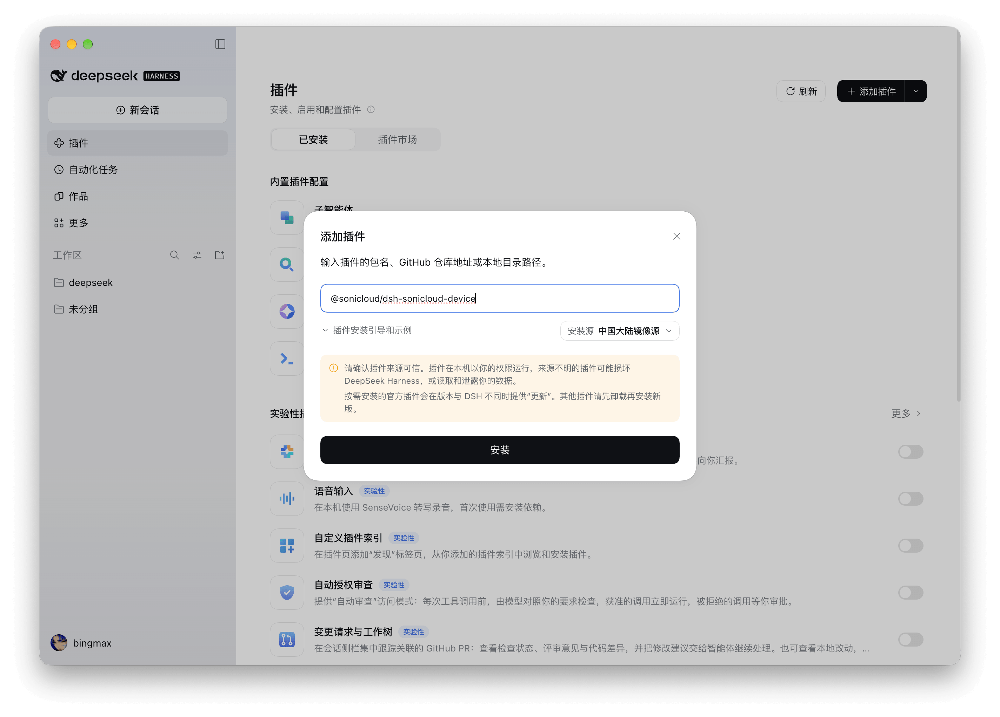
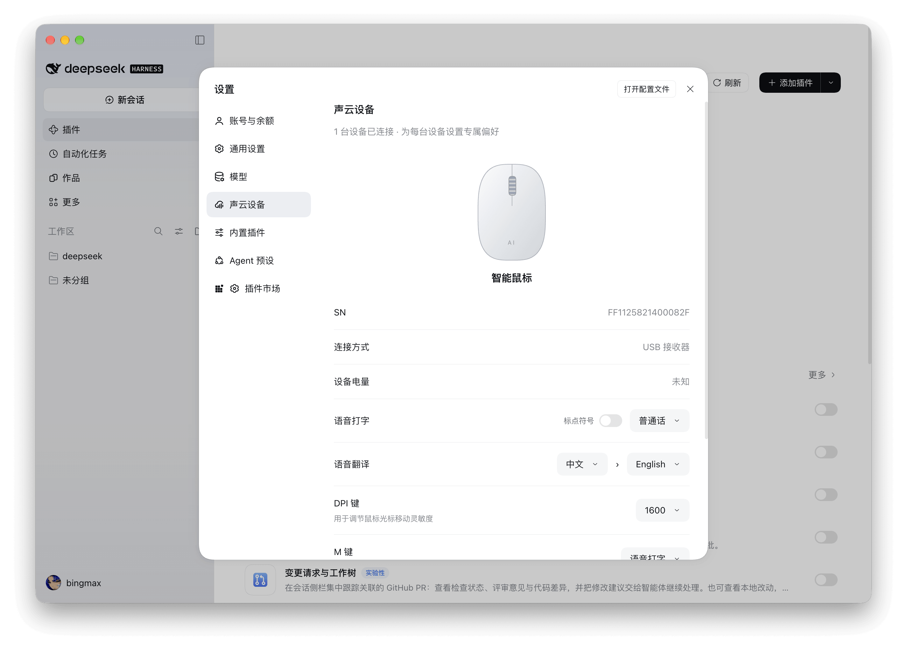
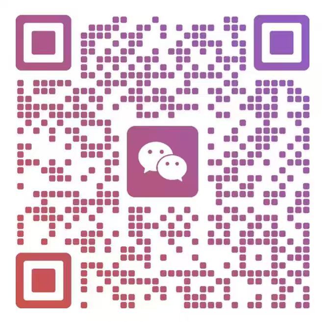

# 声云智能鼠标插件

<a href="README.md">English</a> | 简体中文

用声云智能鼠标在桌面应用中语音打字、翻译和搜索，也可以直接向 DeepSeek Harness 的 AI 对话输入文字。在“声云设备”中，可为每台鼠标分别设置语言、按键和灵敏度。

**购买声云鼠标硬件，即可免费使用语音识别和语音翻译功能。**

## 使用前准备

- DeepSeek Harness **0.2.1-rc.5 或更高版本**。
- 支持本插件的声云智能鼠标，通过蓝牙或 2.4G USB 接收器连接。
- 可访问语音服务的网络。

支持 Apple 芯片 Mac 和 Windows x64。插件会自动识别鼠标并接入服务，无需填写鉴权信息。

## 安装与启用

1. 打开 DeepSeek Harness，进入左侧的**插件**页面。
2. 点击右上角的**添加插件**。
3. 输入 **@sonicloud/dsh-sonicloud-device**，点击**安装**。
4. 安装完成后启用插件，打开**设置 → 声云设备**，即可查看和配置鼠标。

## 你可以做什么

| 功能 | 使用方式 |
| --- | --- |
| 语音打字 | 将语音键或 M 键设为“语音打字”，按住说话，松开后将文字填入当前应用的输入框，不自动发送 |
| 语音翻译 | 选择源语言和目标语言，将语音键或 M 键设为“语音翻译”，按住说话，松开后填入译文 |
| 语音搜索 | 将 M 键设为“语音搜索”，选择百度、Bing 或 Google，说出关键词后松开即可搜索 |
| AI 对话 | 按住 AI 键说话，松开后填入 Harness 对话；“自动发送”默认开启，可在设置中关闭 |
| 自定义按键与灵敏度 | 为 M 键选择回车、后退或一键链接等动作，并调整鼠标 DPI |
| 多设备管理 | 查看每台鼠标的连接方式、电量和序列号，分别保存语言、按键和灵敏度设置 |

在**设置 → 声云设备**中集中管理这些选项。修改后自动保存；“恢复默认”只重置当前鼠标，重新连接后会恢复已保存的设置。

## 开始使用

### 语音输入与翻译

1. 打开鼠标电源，选择蓝牙或 2.4G 模式并完成连接。
2. 在“声云设备”中设置按键动作和语言；翻译时选择不同的源语言和目标语言。
3. 在目标应用的可编辑输入框中放置光标，按住对应按键说话。
4. 松开按键，等待文字或译文填入，检查后自行发送。

录音来自鼠标。识别文字和处理状态显示在屏幕底部的独立浮层，不抢占输入焦点。点击浮层叉号或断开鼠标可取消。多台鼠标可以同时连接，但同一时间只能进行一次语音操作。

录音期间请保持目标窗口、文档和输入位置，不进行键盘编辑、鼠标点击或滚动。目标发生变化或应用不支持自动填入时，浮层会保留结果供复制；翻译失败时可复制识别原文。

macOS 自动填入需要在**系统设置 → 隐私与安全性 → 辅助功能**中允许 **Sonicloud Voice**。没有权限也可以识别并复制结果。macOS 填入文字时会临时使用剪贴板，随后恢复原内容，并保留期间新复制的内容。

### 使用 AI 键

按住 AI 键说话时，Harness 会切到前台：当前在 AI 对话页时使用该对话，否则新建对话。无需先点击输入框，识别文字会追加到已有草稿末尾。

**自动发送**开启时，会提交完整草稿及附件；关闭时只填入文字，供你检查后手动发送。开关按鼠标分别保存，每次录音使用按下时的设置。录音期间切换页面或对话，完成后仍填入本次目标对话；无法唤起、创建或填入时，结果保留在浮层供复制。

### 搜索与一键链接

语音搜索使用当前鼠标的识别语言和所选搜索引擎。使用一键链接时，先填写网址并点击**确认**；可以省略 `https://` 或 `http://`。搜索和打开链接无需先选中输入框，非语音的 M 键动作在松键时执行。

## 更新与卸载

在 Harness 的**插件 → 已安装**中找到声云智能鼠标插件。

- **更新**：在插件的操作菜单中选择**更新**，按界面提示确认。
- **卸载**：在插件的操作菜单中选择**卸载**，按界面提示确认。

## 常见问题

### 接收器已插入但没有设备

确认鼠标已开机、切到 2.4G 模式并已唤醒。若正在运行 ClawMouse 等鼠标管理软件，请完全退出后重试，它们可能占用连接。普通光标能够移动，不代表语音功能已连接。

Mac 上可查看“声云设备”中的占用提示。若提示已检测到接收器、正在等待鼠标响应，请再次检查鼠标电源和连接模式。

### 语音或翻译失败

确认鼠标已被识别、网络可用，且翻译源语言和目标语言不同。鉴权失效时会自动重试一次，仍失败时显示提示。无法自动填入的结果可从浮层复制。

### 设置或按键没有生效

- DPI 应用失败时，重新选择后重试。
- Mac 上的回车、后退等系统按键动作可能需要为 Harness 授予辅助功能权限。
- 提示原语言不再支持时，请重新选择语言。
- 一键链接需要点击**确认**后才生效。

### Harness 需要一直打开吗？

需要保持 Harness 和插件运行。主窗口最小化或隐藏不影响语音处理，但完全退出 Harness 后无法使用鼠标语音功能，AI 键也不能启动已退出的宿主。

## 联系方式

商务合作、技术支持或购买鼠标硬件，请通过以下方式联系我们：

- 邮箱：[xu_heng_yu@sinicloud.com](mailto:xu_heng_yu@sinicloud.com)
- 微信：扫描下方二维码。

## 更多信息

- [更新日志](CHANGELOG.zh.md)
- [开发与贡献指南](docs/contributing/development.md)

项目代码使用 [MIT 许可](LICENSE)。随包原生 SDK 和第三方库保留各自许可，见[组件声明](native/THIRD_PARTY_LICENSES.txt)。
